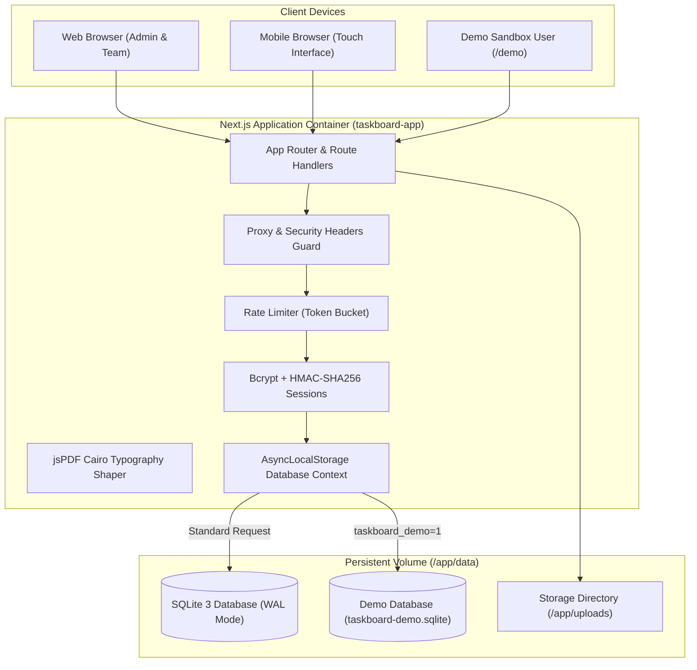

<div align="center">

<a href="https://github.com/red-shadows-rs/taskboard">
  
</a>

# Taskboard

Self-hosted Kanban project management platform with SQLite WAL engine, isolated live demo sandbox, task pricing calculation, and bidirectional Arabic/English typography.

[](CHANGELOG.md)
[](LICENSE)


</div>

---

## Language

<a href="README.md">🇬🇧 English</a> · <a href="README_AR.md">🇸🇦 العربية</a>

---

## Table of Contents

- [Overview](#overview)
- [Live Demo](#live-demo)
- [Comparison](#comparison)
- [Key Features](#features)
- [System Architecture](#architecture)
- [Tech Stack](#tech-stack)
- [Project Structure](#project-structure)
- [Requirements](#requirements)
- [Quick Start](#quick-start)
- [Available Commands](#commands)
- [FAQ](#faq)
- [Documentation](#documentation)
- [Contributing](#contributing)
- [License](#license)

---

<a id="live-demo"></a>

## Live Demo

Experience Taskboard in a fully functional, interactive sandbox pre-populated with bilingual projects, tasks, Kanban boards, and team members:

<div align="center">

[](https://taskboard.red-shadows-rs.com/demo)

**[Launch Live Demo](https://taskboard.red-shadows-rs.com/demo)** (One-click instant login - no registration required)

</div>

---

<a id="overview"></a>

## Overview

**Taskboard** is a self-hosted, all-in-one task and project management platform designed for engineering teams, software agencies, and enterprises. It replaces fragmented proprietary cloud boards (Trello, Jira, Asana) with a unified, air-gapped system running entirely on your own infrastructure with **zero external SaaS dependencies**.

Powered by Next.js 16 App Router, SQLite 3 (via Drizzle ORM) in WAL mode, and native bidirectional Cairo/Inter typography, Taskboard delivers lightning-fast task workflows, member hourly rate tracking, project analytics, and PDF reporting out of the box.

---

<a id="comparison"></a>

## Comparison

| Capability                      |     Trello     |     Jira      |     Asana     |    Monday    |        **Taskboard**        |
| :------------------------------ | :------------: | :-----------: | :-----------: | :----------: | :-------------------------: |
| Self-Hosted & Air-Gapped        |    ❌ SaaS     | ❌ Cloud only |    ❌ SaaS    |   ❌ SaaS    |      ✅ Docker / Linux      |
| Arabic RTL Native Typography    |    ⚠️ Basic    |   ⚠️ Basic    |  ❌ LTR only  | ❌ LTR only  |  ✅ Cairo font & Full RTL   |
| Task Assignee Rates & Budgets   |       ❌       |   ⚠️ Add-on   |   ⚠️ Add-on   |  ⚠️ Add-on   |     ✅ Native built-in      |
| Side-by-Side Bilingual Entities |       ❌       |      ❌       |      ❌       |      ❌      |     ✅ Arabic / English     |
| High-Speed SQLite Storage       | ❌ Proprietary |   ❌ Cloud    |   ❌ Cloud    |   ❌ Cloud   |   ✅ SQLite 3 (WAL mode)    |
| Isolated Demo Sandbox Mode      |       ❌       |      ❌       |      ❌       |      ❌      |    ✅ Instant one-click     |
| External Subscriptions Required |  ❌ \$5-17/mo  | ❌ \$8-15/mo  | ❌ \$11-25/mo | ❌ \$9-19/mo | ✅ Free & Open Source (MIT) |

---

<a id="features"></a>

## Key Features

- **Interactive Kanban Board:** Drag-and-drop tasks across customizable project stages with smooth collision detection and optimistic UI updates.
- **Bilingual by Design:** Native support for Arabic and English throughout the entire application, featuring dedicated side-by-side inputs for titles and rich text descriptions.
- **Isolated Live Demo Sandbox:** Instant one-click evaluation at `/demo` using an isolated SQLite database (`taskboard-demo.sqlite`) that never alters production files.
- **Task Assignee Pricing & Budgeting:** Associate custom hourly/fixed monetary values with task assignees and monitor rolling project totals.
- **Enterprise Role-Based Access Control:** Strict permission boundaries for `leader`, `member`, and `client` roles, secured by bcrypt and HMAC-SHA256 session signatures.
- **Reporting & PDF Export:** Export comprehensive bilingual project, section, task, and analytics summaries with embedded Cairo typography.
- **Private Attachment Storage:** Uploaded task attachments are stored securely outside the web root and served exclusively to authenticated users.

---

<a id="architecture"></a>

## System Architecture

Taskboard operates as an integrated containerized Next.js application communicating with an embedded SQLite database engine:



---

<a id="tech-stack"></a>

## Tech Stack

| Layer             | Technology                                                       |
| :---------------- | :--------------------------------------------------------------- |
| **Framework**     | Next.js 16 (App Router / Turbopack), React 18, TypeScript strict |
| **Database**      | SQLite 3 via `better-sqlite3` + Drizzle ORM                      |
| **Styling**       | Tailwind CSS v3, Radix UI primitives, logical RTL utilities      |
| **Typography**    | Cairo (Arabic) & Inter (English) bundled TrueType fonts          |
| **Kanban Core**   | `@dnd-kit/core` & `@dnd-kit/sortable`                            |
| **PDF Rendering** | jsPDF with embedded vector shaping and autotable layouts         |
| **Cryptography**  | Node.js `crypto` (HMAC-SHA256) + `bcryptjs`                      |
| **Test Suite**    | Vitest (unit & integration tests)                                |

---

<a id="project-structure"></a>

## Project Structure

```
taskboard/
├── data/                       # Persistent SQLite databases (WAL mode)
├── docs/                       # Architecture, Deployment, API, and Troubleshooting specifications
├── drizzle/                    # Drizzle ORM SQL migration snapshots
├── nginx/                      # Production Nginx reverse proxy configuration
├── public/                     # Static assets, icons, and locale JSON files
├── scripts/                    # Shell guards (check-comments, check-versions, set-version)
├── src/
│   ├── app/                    # App Router pages, layouts, and API routes
│   ├── components/             # Reusable UI components (Kanban, forms, layouts)
│   ├── contexts/               # Language and store context providers
│   ├── db/                     # Drizzle ORM schema, connection manager, and demo seed
│   ├── types/                  # TypeScript interface declarations
│   └── utils/                  # PDF export, pricing math, and sanitization utilities
├── docker-compose.yml          # Production container orchestration
├── Dockerfile                  # Multi-stage production container build
├── package.json                # Project dependencies and script runner
└── tsconfig.json               # Strict TypeScript configuration
```

---

<a id="requirements"></a>

## Requirements

- **Runtime:** Node.js >= 20.9 (Node 22 LTS recommended)
- **Package Manager:** npm >= 10
- **Database:** SQLite 3 (handled transparently via `better-sqlite3`)
- **Containerization (Optional):** Docker Engine >= 24.0, Docker Compose v2

---

<a id="quick-start"></a>

## Quick Start

### 1. Clone & Install

```bash
git clone https://github.com/red-shadows-rs/taskboard.git
cd taskboard
npm install
```

### 2. Environment Configuration

```bash
cp .env.example .env.local
# Generate SESSION_SECRET:
openssl rand -base64 48
```

Edit `.env.local` and set `SESSION_SECRET=<generated_key>`.

### 3. Initialize Database & Seed

```bash
# Run database migrations and seed default data
npm run db:migrate
npm run db:seed
```

### 4. Start Development Server

```bash
npm run dev
```

Open [http://localhost:3000](http://localhost:3000) and sign in using the bootstrap credentials or click **Launch Live Demo**.

---

<a id="commands"></a>

## Available Commands

| Command                  | Description                                    |
| :----------------------- | :--------------------------------------------- |
| `npm run dev`            | Start development server with Turbopack        |
| `npm run build`          | Compile Next.js production standalone build    |
| `npm start`              | Start standalone production server             |
| `npm run type-check`     | Run TypeScript compiler strict validation      |
| `npm run lint`           | Run ESLint static code analysis                |
| `npm run check:comments` | Enforce code comment policy guard              |
| `npm run check:versions` | Validate version consistency across files      |
| `npm test`               | Run Vitest unit and integration test suite     |
| `npm run db:generate`    | Generate SQL migrations from schema            |
| `npm run db:migrate`     | Execute database migrations and initialization |
| `npm run db:seed`        | Seed initial admin and demo datasets           |

---

<a id="faq"></a>

## FAQ

<details>
<summary><b>Does Taskboard require an external database server or cloud connection?</b></summary>
<br>
No. Taskboard embeds SQLite 3 with Write-Ahead Logging (WAL) enabled directly via Better-SQLite3 and Drizzle ORM. All data is persisted locally in the mounted <code>data/</code> volume without needing PostgreSQL, MySQL, or internet access.
</details>

<details>
<summary><b>How is the live demo sandbox isolated from production data?</b></summary>
<br>
When a visitor accesses <code>/demo</code>, Taskboard establishes an isolated demo session bound to a separate sandbox database (<code>taskboard-demo.sqlite</code>) via AsyncLocalStorage. Modifications made in the demo sandbox never mutate or read production data.
</details>

<details>
<summary><b>Can Taskboard track assignee hourly rates and project costs?</b></summary>
<br>
Yes. Taskboard features a built-in financial calculation engine. Leaders can configure monetary rates per assignee and monitor aggregate project budgets with live currency formatting for SAR and USD.
</details>

<details>
<summary><b>How does Taskboard handle bilingual Arabic and English content?</b></summary>
<br>
Every task, section, and project provides dedicated side-by-side inputs for Arabic and English titles and rich text descriptions. When switching languages, the UI smoothly mirrors between RTL and LTR with native Cairo and Inter font families.
</details>

<details>
<summary><b>How do I deploy Taskboard in production?</b></summary>
<br>
Taskboard ships with an optimized multi-stage Dockerfile and a production Docker Compose specification. Simply run <code>docker compose up -d</code> behind the provided Nginx reverse proxy configuration.
</details>

---

<a id="documentation"></a>

## Documentation

| Document                                      | Description                                                     |
| --------------------------------------------- | --------------------------------------------------------------- |
| [ARCHITECTURE.md](docs/ARCHITECTURE.md)       | System topology, database design, and Kanban state machine      |
| [DEPLOYMENT.md](docs/DEPLOYMENT.md)           | Production Docker Compose, Nginx SSL reverse proxy, and backups |
| [API_SPEC.md](docs/API_SPEC.md)               | REST API endpoints, payload schemas, and health check routes    |
| [TROUBLESHOOTING.md](docs/TROUBLESHOOTING.md) | Common diagnostic procedures and operational fixes              |

---

<a id="contributing"></a>

## Contributing

1. Fork the repository and create a branch (`feature/`, `fix/`, `docs/`, `chore/`).
2. Ensure all verification checks pass: `npm run validate` and `npm run check:comments`.
3. Add a `CHANGELOG.md` entry.
4. Commit as `taskboard | <type>: <description>` and open a pull request against `main`.

Read the [Contributing Guidelines](CONTRIBUTING.md) and the [Code of Conduct](CODE_OF_CONDUCT.md). Report problems through [GitHub Issues](https://github.com/red-shadows-rs/taskboard/issues).

---

<a id="license"></a>

## License

Distributed under the [GNU General Public License v3.0](LICENSE).

---

<div align="center">

Built by <a href="https://github.com/red-shadows-rs">RED SHADOWS | RS</a> (<a href="https://github.com/shadow-x78">shadow-x78</a>) ·
[Changelog](CHANGELOG.md) ·
[Security](SECURITY.md)

<sub>&copy; 2026 Taskboard - RED SHADOWS | RS (shadow-x78)</sub>

</div>
