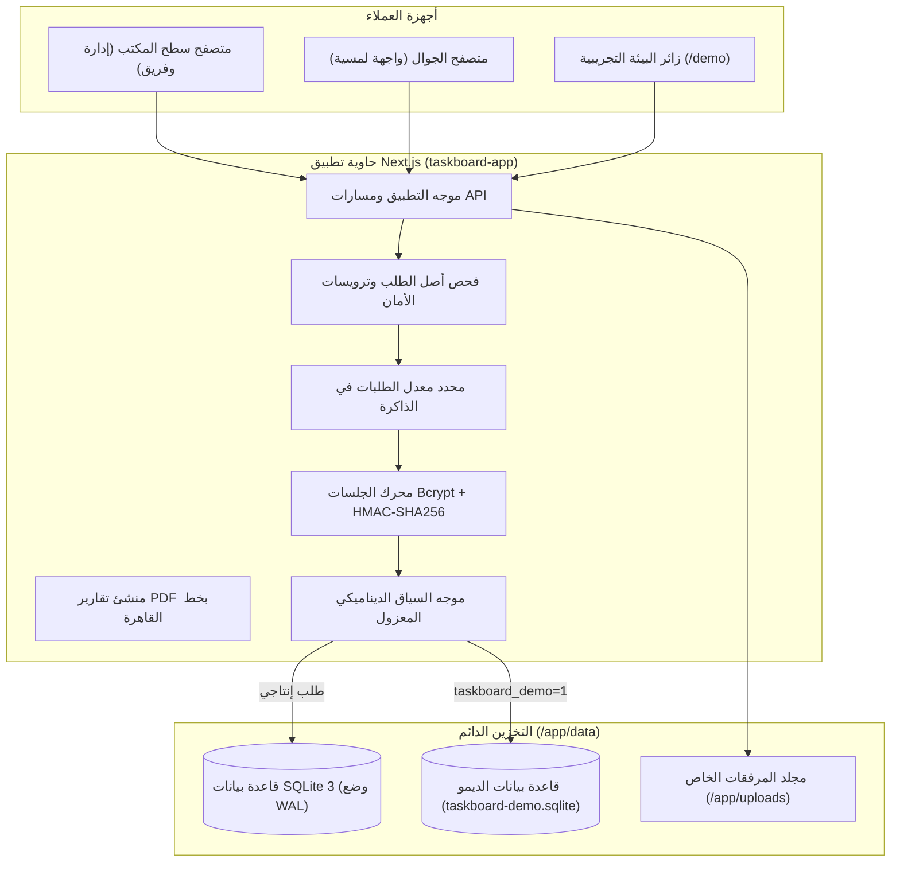

<div align="center">

<a href="https://github.com/red-shadows-rs/taskboard">
  
</a>

# تاسك بورد (TaskBoard)

منصة إدارة مهام ومشاريع بنمط كانبان ذاتية الاستضافة مع محرك SQLite WAL، وبيئة تجريبية معزولة للديمو، وحسابات تسعير المهام، وواجهة ثنائية اللغة (عربي / إنجليزي).

[](CHANGELOG.md)
[](LICENSE)


</div>

---

## اللغة

<a href="README.md">🇬🇧 English</a> · <a href="README_AR.md">🇸🇦 العربية</a>

---

## جدول المحتويات

- [نظرة عامة](#overview)
- [الديمو الحي](#live-demo)
- [المقارنة مع المنصات الأخرى](#comparison)
- [الميزات الرئيسية](#features)
- [معمارية النظام](#architecture)
- [حزمة التقنيات](#tech-stack)
- [هيكلية المشروع](#project-structure)
- [المتطلبات](#requirements)
- [البدء السريع](#quick-start)
- [الأوامر المتاحة](#commands)
- [التوثيق الشامل](#documentation)
- [المساهمة](#contributing)
- [الترخيص](#license)

---

<a id="live-demo"></a>

## الديمو الحي

جرّب TaskBoard في بيئة تجريبية تفاعلية بالكامل ومعزولة، مهيأة مسبقاً بمشاريع ومهام ولوحات كانبان وأعضاء فريق باللغتين العربية والإنجليزية:

<div align="center">

[](https://taskboard.red-shadows-rs.com/demo)

**[تشغيل الديمو الحي](https://taskboard.red-shadows-rs.com/demo)** (تسجيل دخول فوري بنقرة واحدة - لا يلزم التسجيل أو كلمة المرور)

</div>

---

<a id="overview"></a>

## نظرة عامة

منصة **TaskBoard** هي نظام ذاتي الاستضافة ومتكامل لإدارة المهام والمشاريع بنمط كانبان، مصمم خصيصاً للفرق الهندسية وشركات تطوير البرمجيات والمؤسسات. يستبدل النظام الأدوات السحابية المغلقة والمشتتة (مثل Trello و Jira و Asana) ببيئة عمل موحدة ومستقلة تعمل بالكامل على خادمك الخاص دون **أي اعتمادية على خدمات سحابية خارجية (Zero SaaS Dependencies)**.

يعمل النظام بواسطة Next.js 16 App Router، وقاعدة بيانات SQLite 3 بوضع WAL فائق السرعة عبر Drizzle ORM، مع دعم حقيقي لتخطيطات RTL/LTR وخط القاهرة الأصيل، مما يوفر سلاسة فائقة في إدارة المهام، وتتبع التكاليف ومعدلات أسعار الأعضاء، والتقارير المالية، وتصدير ملفات PDF.

---

<a id="comparison"></a>

## المقارنة مع المنصات الأخرى

| الميزة                              |    Trello     |      Jira       |      Asana      |     Monday      |        **TaskBoard**         |
| :---------------------------------- | :-----------: | :-------------: | :-------------: | :-------------: | :--------------------------: |
| استضافة ذاتية واستقلالية سحابية     |   ❌ سحابي    |    ❌ سحابي     |    ❌ سحابي     |    ❌ سحابي     |      ✅ Docker / Linux       |
| طباعة عربية أصيلة بدعم كامل للـ RTL |    ⚠️ بسيط    |     ⚠️ بسيط     |   ❌ LTR فقط    |   ❌ LTR فقط    |   ✅ خط القاهرة و RTL كامل   |
| ميزانيات وأسعار مخصصة لكل منفّذ     |      ❌       | ⚠️ إضافة مدفوعة | ⚠️ إضافة مدفوعة | ⚠️ إضافة مدفوعة |        ✅ مدمج أصلياً        |
| حقول إدخال ثنائية اللغة متزامنة     |      ❌       |       ❌        |       ❌        |       ❌        |      ✅ عربي / إنجليزي       |
| تخزين محلي سريع بواسطة SQLite WAL   |    ❌ مغلق    |    ❌ سحابي     |    ❌ سحابي     |    ❌ سحابي     |    ✅ SQLite 3 (وضع WAL)     |
| بيئة ديمو معزولة تفاعلية فورية      |      ❌       |       ❌        |       ❌        |       ❌        |        ✅ بنقرة واحدة        |
| اشتراكات شهرية مدفوعة               | ❌ \$5-17/شهر |  ❌ \$8-15/شهر  | ❌ \$11-25/شهر  |  ❌ \$9-19/شهر  | ✅ مجاني ومفتوح المصدر (MIT) |

---

<a id="features"></a>

## الميزات الرئيسية

- **لوحة كانبان تفاعلية:** سحب وإفلات المهام بين مراحل المشروع مع استشعار مرن للتصادم وتحديثات تفاؤلية فورية.
- **ثنائي اللغة من الأساس:** دعم أصيل للغة العربية والإنجليزية عبر النظام كاملاً، مع حقول مستقلة متزامنة للعناوين والوصف التحريري.
- **بيئة ديمو معزولة تماماً:** وصول فوري عبر المسار `/demo` بقاعدة بيانات SQLite معزولة (`taskboard-demo.sqlite`) تضمن عدم لمس بيانات الإنتاج أبداً مع إمكانية إعادة الضبط بضغطة زر.
- **تسعير مهام منفذي الفريق:** ربط أسعار مالية مخصصة لكل عضو في المهمة واحتساب الميزانيات التراكمية للمشروع تلقائياً.
- **إدارة صلاحيات مبنية على الأدوار:** حدود أمان دقيقة بين القائد (`leader`) والعضو (`member`) والعميل (`client`) محمية بكلمات مرور Bcrypt وتوقيعات HMAC-SHA256.
- **تقارير وتصدير PDF:** إنشاء وطباعة تقارير شاملة للمشاريع والمهام والتحليلات بخط القاهرة المدمج دون الحاجة للاتصال بالإنترنت.
- **مرفقات خاصة وآمنة:** تخزين المرفقات والصور خارج المجلد العام وتقديمها حصرياً للمستخدمين المصادقين.

---

<a id="architecture"></a>

## معمارية النظام

يعمل TaskBoard كتطبيق حاوية Next.js موحد يتصل مباشرة بمحرك قاعدة بيانات SQLite المدمج:



---

<a id="tech-stack"></a>

## حزمة التقنيات

| الطبقة              | التقنية المستخدمة                                              |
| :------------------ | :------------------------------------------------------------- |
| **إطار العمل**      | Next.js 16 (App Router / Turbopack)، React 18، TypeScript صارم |
| **قاعدة البيانات**  | SQLite 3 عبر `better-sqlite3` مع Drizzle ORM                   |
| **التصميم**         | Tailwind CSS v3 مع مكونات Radix UI وتخطيطات RTL المنطقية       |
| **الخطوط**          | خط القاهرة (Cairo) للعربية و Inter للإنجليزية مدمجة دون اتصال  |
| **محرك كانبان**     | `@dnd-kit/core` و `@dnd-kit/sortable`                          |
| **تصدير PDF**       | jsPDF مع جداول autotable وتشكيل خطوط الفكتور                   |
| **الأمان والتشفير** | Node.js `crypto` (HMAC-SHA256) مع `bcryptjs`                   |
| **حزمة الاختبارات** | Vitest (اختبارات الوحدة والتكامل)                              |

---

<a id="project-structure"></a>

## هيكلية المشروع

```
taskboard/
├── data/                       # قواعد بيانات SQLite الدائمة (وضع WAL)
├── docs/                       # وثائق المعمارية والنشر والواجهات واستكشاف الأخطاء
├── drizzle/                    # لقطات ترحيل Drizzle ORM بصيغة SQL
├── nginx/                      # تكوين خادم Nginx الوسيط العكسي للإنتاج
├── public/                     # الأصول الثابتة والأيقونات وملفات الترجمة JSON
├── scripts/                    # أدوات حراسة السياسات والتحقق من الإصدارات
├── src/
│   ├── app/                    # صفحات App Router والمسارات البرمجية API
│   ├── components/             # مكونات واجهة المستخدم ولوحات كانبان والنماذج
│   ├── contexts/               # مزودات سياق اللغة وحالة المتجر
│   ├── db/                     # مخطط Drizzle وإدارة الاتصال وبيانات الديمو
│   ├── types/                  # تعريفات الأنواع في TypeScript
│   └── utils/                  # أدوات تصدير PDF وحساب الأسعار والتطهير
├── docker-compose.yml          # إدارة وتشغيل حاويات الإنتاج
├── Dockerfile                  # بناء حاوية الإنتاج متعدد المراحل
├── package.json                # حزم المشروع ومشغل السكربتات
└── tsconfig.json               # إعدادات TypeScript الصارمة
```

---

<a id="requirements"></a>

## المتطلبات

- **بيئة التشغيل:** Node.js >= 20.9 (يوصى بـ Node 22 LTS)
- **مدير الحزم:** npm >= 10
- **قاعدة البيانات:** SQLite 3 (تدار ذاتياً عبر `better-sqlite3`)
- **الحاويات (اختياري):** Docker Engine >= 24.0 و Docker Compose v2

---

<a id="quick-start"></a>

## البدء السريع

### 1. الاستنساخ والتثبيت

```bash
git clone https://github.com/red-shadows-rs/taskboard.git
cd taskboard
npm install
```

### 2. تكوين البيئة

```bash
cp .env.example .env.local
# توليد مفتاح الجلسة:
openssl rand -base64 48
```

قم بفتح `.env.local` وضع المفتاح المولد في `SESSION_SECRET=<المفتاح>`.

### 3. تهيئة وبذر قاعدة البيانات

```bash
# تشغيل الترحيل وبذر البيانات الافتراضية
npm run db:migrate
npm run db:seed
```

### 4. تشغيل خادم التطوير

```bash
npm run dev
```

افتح الرابط [http://localhost:3000](http://localhost:3000) وسجل الدخول بالحساب الافتراضي أو انقر على **تشغيل الديمو الحي**.

---

<a id="commands"></a>

## الأوامر المتاحة

| الأمر                    | الوصف                                      |
| :----------------------- | :----------------------------------------- |
| `npm run dev`            | تشغيل خادم التطوير بواسطة Turbopack        |
| `npm run build`          | بناء ملفات الإنتاج المجمعة (Standalone)    |
| `npm start`              | تشغيل خادم الإنتاج المستقل                 |
| `npm run type-check`     | فحص الأنواع بواسطة مجمع TypeScript         |
| `npm run lint`           | إجراء التحليل الساكن للكود عبر ESLint      |
| `npm run check:comments` | فرض سياسة خلو الكود من التعليقات الداخلية  |
| `npm run check:versions` | التحقق من تطابق أرقام الإصدارات في الملفات |
| `npm test`               | تشغيل حزمة اختبارات Vitest                 |
| `npm run db:generate`    | توليد ترحيلات SQL من المخطط البرمجي        |
| `npm run db:migrate`     | تنفيذ ترحيلات وتهيئة قاعدة بيانات SQLite   |
| `npm run db:seed`        | بذر البيانات التجريبية وبيانات الأدمن      |

---

<a id="documentation"></a>

## التوثيق الشامل

| المستند                                             | الوصف                                                               |
| --------------------------------------------------- | ------------------------------------------------------------------- |
| [ARCHITECTURE_AR.md](docs/ARCHITECTURE_AR.md)       | معمارية النظام، تصميم قاعدة البيانات، ومحرك كانبان                  |
| [DEPLOYMENT_AR.md](docs/DEPLOYMENT_AR.md)           | دليل النشر الإنتاجي عبر Docker Compose وخادم Nginx والنسخ الاحتياطي |
| [API_SPEC_AR.md](docs/API_SPEC_AR.md)               | دليل مسارات REST API ومخططات الطلبات وفحص السلامة                   |
| [TROUBLESHOOTING_AR.md](docs/TROUBLESHOOTING_AR.md) | الإجراءات التشخيصية الشائعة وحلول المشكلات التشغيلية                |

---

<a id="contributing"></a>

## المساهمة

1. قم بعمل Fork للمستودع وأنشئ فرعاً جديداً (`feature/` أو `fix/` أو `docs/`).
2. تأكد من اجتياز جميع الفحوصات: `npm run validate` و `npm run check:comments`.
3. أضف سجلاً في ملف `CHANGELOG.md`.
4. اكتب الكوميت بالصيغة القياسية: `taskboard | <نوع>: <الوصف>` وافتح Pull Request.

راجع [إرشادات المساهمة](CONTRIBUTING.md) و [ميثاق السلوك](CODE_OF_CONDUCT.md).

---

<a id="license"></a>

## الترخيص

مرخص تحت [ترخيص MIT](LICENSE).

---

<div align="center">

صُنع بواسطة <a href="https://github.com/red-shadows-rs">RED SHADOWS | RS</a> (<a href="https://github.com/shadow-x78">shadow-x78</a>) ·
[سجل التغييرات](CHANGELOG.md) ·
[سياسة الأمان](SECURITY.md)

<sub>&copy; 2026 TaskBoard - RED SHADOWS | RS (shadow-x78)</sub>

</div>
