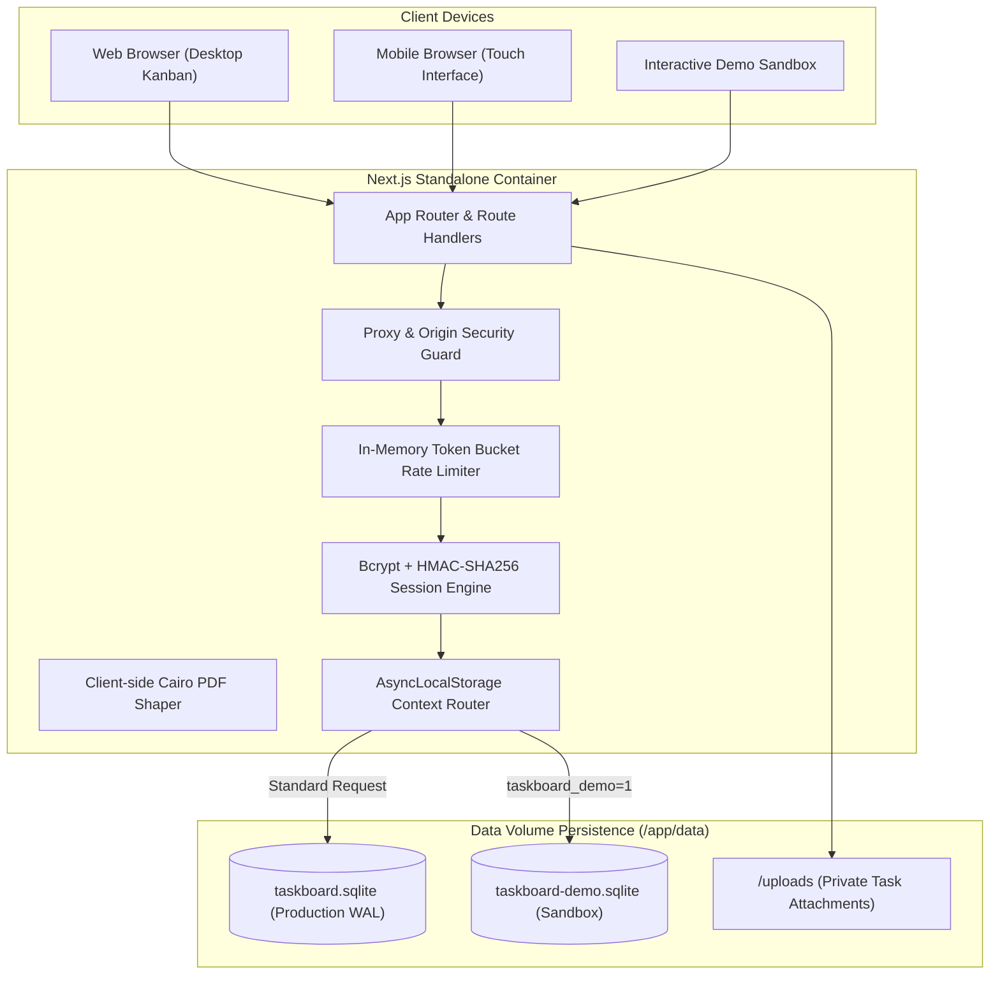
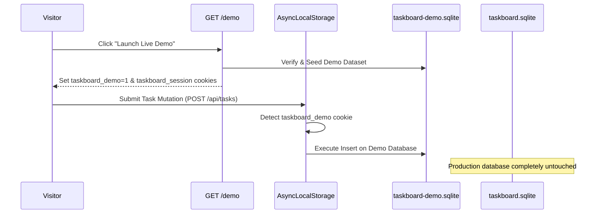

# Architecture Specification - TaskBoard

---

## Language

<a href="ARCHITECTURE.md">🇬🇧 English</a> · <a href="ARCHITECTURE_AR.md">🇸🇦 العربية</a>

---

TaskBoard is a high-performance, self-hosted project and task management platform engineered for engineering teams, agencies, and enterprises. Built with Next.js App Router, SQLite (via Drizzle ORM), and strict bidirectional RTL/LTR interfaces, TaskBoard replaces fragmented external SaaS boards with an air-gapped, zero-cloud system under your complete control.

---

## Table of Contents

- [Core Principles](#core-principles)
- [System Architecture Overview](#system-architecture-overview)
- [Database Engine & WAL Persistence](#database-engine)
- [Isolated Live Demo Sandbox](#sandbox-architecture)
- [Kanban Drag-and-Drop State Machine](#kanban-architecture)
- [Security & Authentication Model](#security-model)
- [Financial & Pricing Calculation Engine](#financial-engine)
- [Reporting & PDF Export Pipeline](#pdf-pipeline)

---

## Core Principles

1. **Zero External SaaS Dependencies:** Completely self-hosted; SQLite 3 in WAL mode, local file system attachment storage, offline Cairo fonts, and zero telemetry.
2. **First-Class Bilingual Architecture:** Native Arabic (RTL) and English (LTR) layout switching with side-by-side mirrored typography and bilingual validation.
3. **Database Isolation & Deterministic Sandbox:** Zero-risk demo exploration through dedicated SQLite database isolation (`taskboard-demo.sqlite`) that never touches production files.
4. **Role-Based Access Control (RBAC):** Strict boundaries separating `leader` (administrative oversight, project creation, pricing visibility), `member` (task assignment, status transitions), and `client` (read-only project inspection).

---

## System Architecture Overview

The system operates as an integrated containerized Next.js standalone application communicating with a high-speed SQLite database engine:

---

## Database Engine & WAL Persistence

TaskBoard utilizes SQLite 3 managed through **Drizzle ORM** and **better-sqlite3**.

### Performance Pragmas

Upon each database connection, the engine enforces:

- `journal_mode = WAL`: Write-Ahead Logging allows concurrent readers alongside a single writer with zero reader contention.
- `foreign_keys = ON`: Strict relational cascades (deleting a project cascades to sections and tasks).
- `busy_timeout = 5000`: Thread-safe wait period avoiding lock contention.
- `synchronous = NORMAL`: Flushes at critical checkpoints while providing optimal I/O throughput.

### Schema Relationships

- **Projects (1) &rarr; (N) Sections:** Projects organize workflows into customizable Kanban columns.
- **Sections (1) &rarr; (N) Tasks:** Tasks belong to a specific stage and support drag-and-drop reordering.
- **Users (1) &rarr; (N) Tasks:** Tasks track assignees as JSON references with custom hourly/fixed pricing.

---

## Isolated Live Demo Sandbox

To provide prospective teams with an instant evaluation environment without contaminating production data, TaskBoard implements scoped database routing:

- **Reset Protocol (`POST /api/demo/reset`):** Wipes demo tables and deterministically re-seeds default projects and tasks in under 15ms.
- **Exit Protocol (`POST /api/demo/exit`):** Clears session tokens and redirects to `/login`.

---

## Kanban Drag-and-Drop State Machine

The Kanban board relies on `@dnd-kit/core` and `@dnd-kit/sortable`:

- **Collision Detection:** Uses closest-center algorithms to resolve target drop zones between horizontal sections and vertical task slots.
- **Optimistic Reconciliation:** Reorders state in memory immediately, dispatching debounced reorder payloads to `/api/tasks/reorder` and `/api/sections/reorder`.
- **Sensors:** Employs PointerSensor and TouchSensor configurations to enable smooth drag gestures across both desktop mice and mobile touchscreens.

---

## Security & Authentication Model

### Session Sealing

Sessions are authenticated via cryptographically signed cookies:
`taskboard_session = signature.sessionData`
Where `signature = HMAC-SHA256(sessionData, SESSION_SECRET)` verified with constant-time equality check (`timingSafeEqual`) to prevent timing side-channel attacks.

### Request Protection

- **CSRF / Origin Check (`src/proxy.ts`):** Validates origin and host headers on all mutating verbs (POST, PUT, PATCH, DELETE).
- **Security Headers:** Strict Content-Security-Policy (CSP), X-Frame-Options (`DENY`), X-Content-Type-Options (`nosniff`), Referrer-Policy (`strict-origin-when-cross-origin`), and Permissions-Policy.
- **Attachment Isolation:** Uploaded files are stored outside `public/` and streamed only to authenticated users through `/api/images/[...path]`.

---

## Financial & Pricing Calculation Engine

TaskBoard provides leaders with project financial oversight:

- **Assignee Rates:** Every task can associate customized monetary rates per assignee.
- **Project Total Aggregation:** Dynamically rolls up completed, in-progress, and planned task values into project budgets.
- **Currency Formatting:** Automatically formats currencies into Saudi Riyal (SAR) and US Dollars (USD) according to the active locale.

---

## Reporting & PDF Export Pipeline

Exporting project summaries and task sheets is handled via **jsPDF** and **jspdf-autotable**:

- **Offline Fonts:** Bundles the Cairo font family as Base64 TrueType fonts for high-fidelity Arabic rendering.
- **Bidirectional Table Layout:** Automatically mirrors headers, borders, and column alignments based on active document language.

---

Built by <a href="https://github.com/red-shadows-rs">RED SHADOWS | RS</a> (<a href="https://github.com/shadow-x78">shadow-x78</a>)

