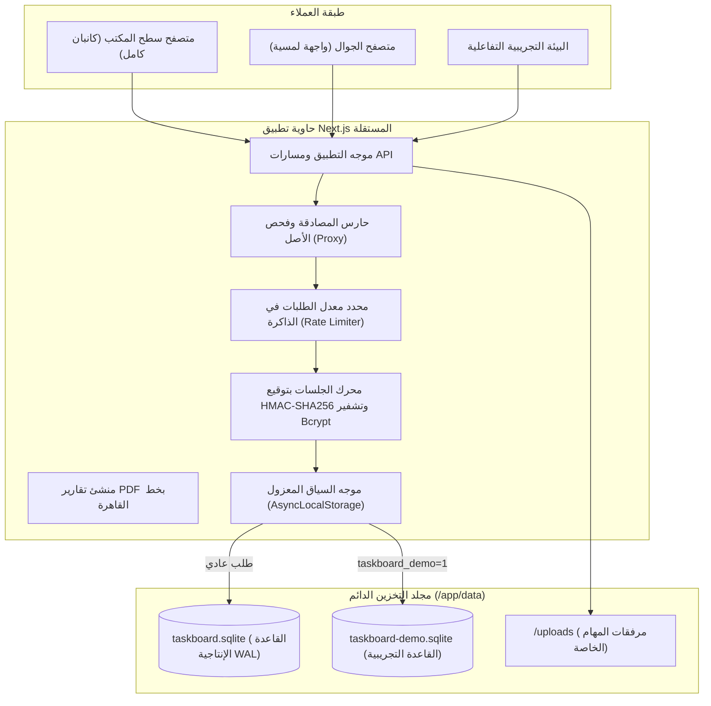
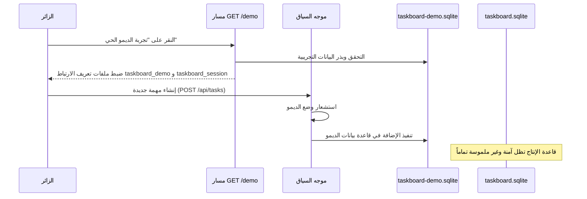

# دليل المواصفات المعمارية - Taskboard

---

## اللغة

<a href="ARCHITECTURE.md">🇬🇧 English</a> · <a href="ARCHITECTURE_AR.md">🇸🇦 العربية</a>

---

نظام **Taskboard** هو منصة متقدمة لإدارة المهام والمشاريع بنمط كانبان (Kanban)، صُممت خصيصاً للفرق الهندسية والمؤسسات والشركات التقنية. يعتمد النظام على Next.js App Router وقاعدة بيانات SQLite مدمجة ومُدارة بواسطة Drizzle ORM، مع دعم حقيقي وكامل للواجهات ثنائية الاتجاه (RTL/LTR)، موفراً بديلاً آمناً ومستقلاً عن الخدمات السحابية الخارجية.

---

## جدول المحتويات

- [المبادئ الأساسية](#core-principles)
- [نظرة عامة على المعمارية](#system-architecture-overview)
- [محرك قاعدة البيانات ووضع WAL](#database-engine)
- [معمارية بيئة الديمو التجريبية المعزولة](#sandbox-architecture)
- [محرك السحب والإفلات لكانبان](#kanban-architecture)
- [نموذج الأمان والمصادقة](#security-model)
- [محرك الحسابات المالية والتسعير](#financial-engine)
- [خط إنتاج تقارير PDF المزدوجة](#pdf-pipeline)

---

## المبادئ الأساسية

1. **الاستقلالية التامة عن الخدمات السحابية:** استضافة ذاتية بالكامل؛ قاعدة بيانات SQLite 3 بوضع تسجيل المعاملات الاستباقي (WAL)، تخزين محلي آمن للمرفقات، وخطوط عربية مدمجة دون طلبات خارجية.
2. **معمارية ثنائية اللغة من الأساس:** دعم أصيل للغة العربية والإنجليزية مع تبديل متناسق لاتجاه الواجهة (RTL/LTR) وخط القاهرة المتناسق وحقول إدخال مستقلة ومفحوصة لكلتا اللغتين.
3. **عزل كامل للبيئة التجريبية (Sandbox):** تجربة تفاعلية آمنة وسريعة عبر فصل قواعد البيانات (`taskboard-demo.sqlite`) لضمان عدم المساس بالبيانات الإنتاجية نهائياً.
4. **التحكم بالصلاحيات بناءً على الأدوار (RBAC):** حدود واضحة تفصل بين القائد (`leader`) مع رؤية التسعير وإدارة الفرق والمشاريع، والعضو (`member`) لإنجاز وتحديث المهام، والعميل (`client`) للمعاينة والاطلاع.

---

## نظرة عامة على المعمارية

يعمل النظام كحاوية Next.js مستقلة (Standalone Container) تتصل مباشرة بمحرك SQLite فائق السرعة:

---

## محرك قاعدة البيانات ووضع WAL

تتم إدارة قاعدة بيانات SQLite 3 بواسطة **Drizzle ORM** ومحرك **better-sqlite3**.

### برمجيات تحسين الأداء (Pragmas)

عند فتح الاتصال يتم تفعيل الإعدادات التالية:

- `journal_mode = WAL`: يتيح القراءة المتزامنة دون إعاقة عمليات الكتابة.
- `foreign_keys = ON`: فرض سلامة العلاقات وحذف التبعيات تلقائياً (حذف المشروع يحذف أقسامه ومهامه).
- `busy_timeout = 5000`: فترة انتظار تصل إلى 5 ثوانٍ لتجنب أخطاء قفل الملفات.
- `synchronous = NORMAL`: موازنة مثالية بين أمان البيانات وأقصى سرعة إدخال وإخراج.

---

## معمارية بيئة الديمو التجريبية المعزولة

لتمكين الفرق من تجربة كافة وظائف النظام دون التأثير على بيانات الإنتاج، تم بناء نظام توجيه معزول:

- **إعادة الضبط (`POST /api/demo/reset`):** مسح بيانات الديمو وإعادة بذر المشاريع والمهام الافتراضية في أقل من 15 جزءاً من الثانية.
- **الخروج (`POST /api/demo/exit`):** حذف رموز الجلسة والديمو والتحويل التلقائي لصفحة الدخول.

---

## محرك السحب والإفلات لكانبان

تعتمد لوحة كانبان على مكتبة `@dnd-kit/core` و `@dnd-kit/sortable`:

- **استشعار التصادم:** خوارزميات حساب أقرب مركز لتحديد موقع الإسقاط بين الأعمدة والمهام.
- **التحديث التفاؤلي:** تحديث فوري للحالة على واجهة المستخدم مع إرسال الطلبات في الخلفية لمسارات إعادة الترتيب.
- **دعم الأجهزة اللمسية:** تكامل مستشعرات الفأرة واللمس لضمان تجربة سلسة على الجوال والشاشات اللمسية.

---

## نموذج الأمان والمصادقة

### ختم الجلسات بالتوقيع الرقمي

يتم تشفير وتوقيع الجلسات باستخدام خوارزمية:
`taskboard_session = signature.sessionData`
حيث `signature = HMAC-SHA256(sessionData, SESSION_SECRET)` مع فحص التطابق بالوقت الثابت لمنع هجمات التوقيت.

### حماية الطلبات والمرفقات

- **فحص أصل الطلب (`src/proxy.ts`):** منع هجمات CSRF على جميع الطلبات المعدلة للبيانات.
- **ترويسات الأمان:** تفعيل سياسات CSP و X-Frame-Options و X-Content-Type-Options لمنع هجمات الحقن والتضمين غير المصرح به.
- **عزل المرفقات:** حفظ الملفات المرفوعة خارج مجلد `public/` وتقديمها فقط للمستخدمين المسجلين عبر مسار `/api/images/[...path]`.

---

بُني بواسطة <a href="https://github.com/shadow-x78">shadow-x78</a> ·
[العودة إلى README](../README_AR.md)

&copy; 2026 Taskboard (shadow-x78)

